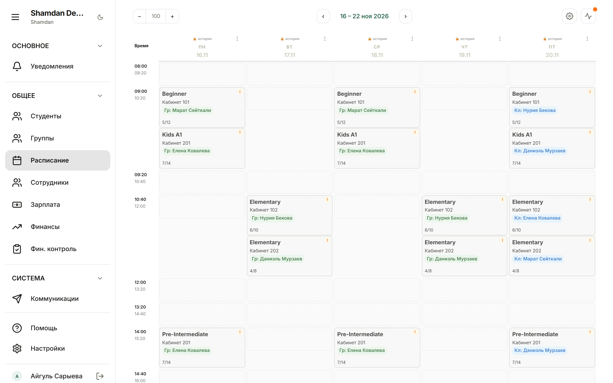
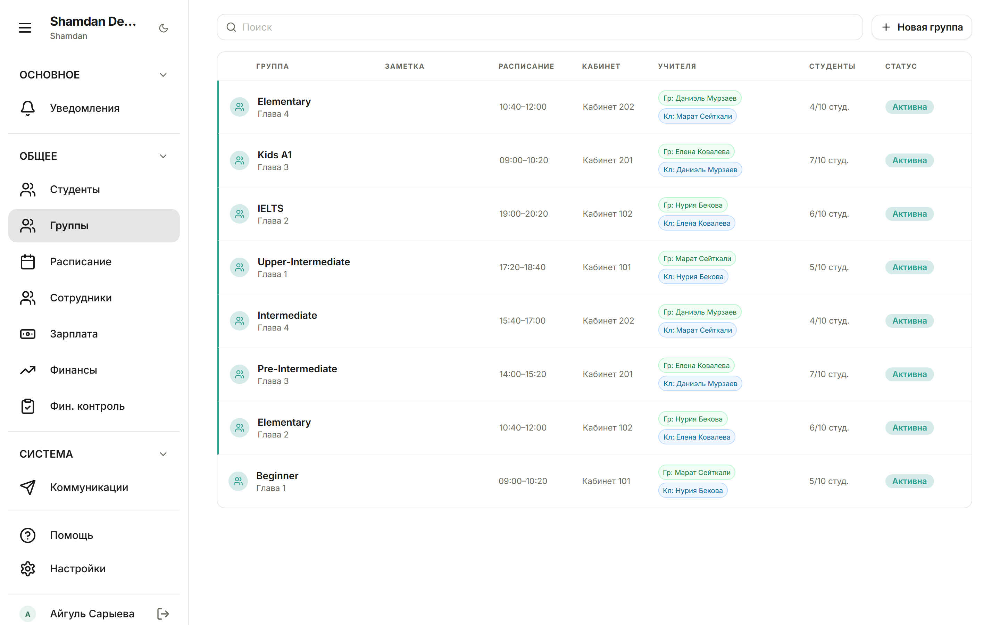
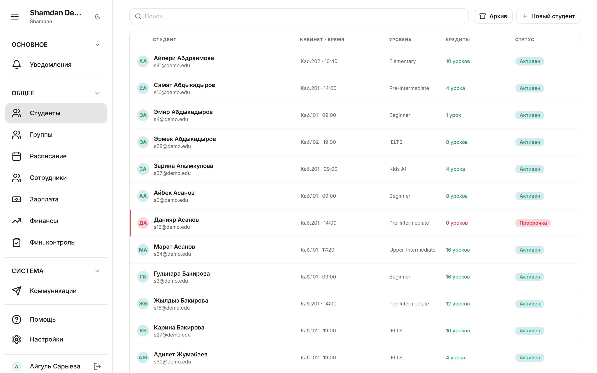
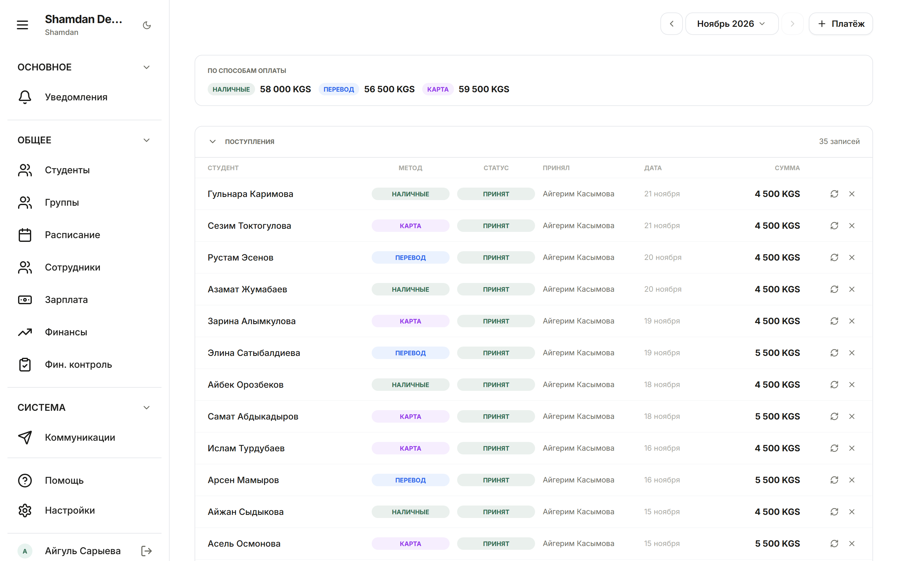
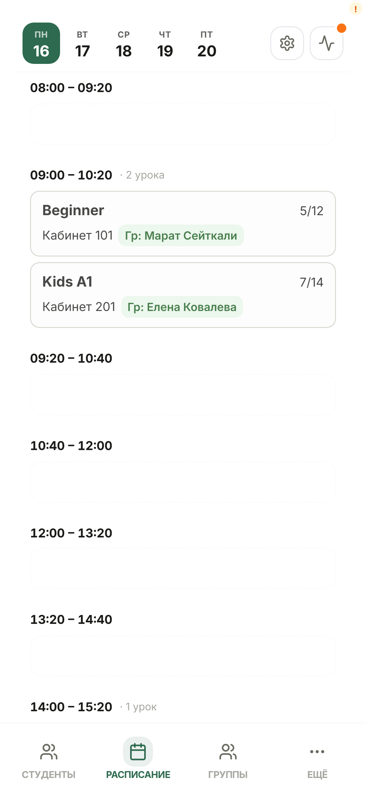
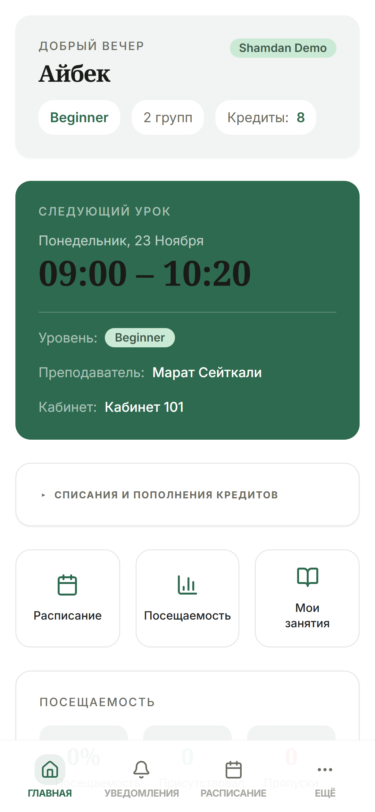

# Shamdan — School Management Platform

**English** · [Русский](#русский)

Multi-tenant SaaS for language schools: scheduling, attendance, a lesson-credit ledger, payroll, finance and communications — one app for owners, admins, teachers and students.

**Stack:** React 19 · TypeScript · Vite · Tailwind · Node.js / Express · PostgreSQL · Prisma · Jest · Playwright · GitHub Actions

> Built by a team of three over ~8 months (760+ commits). This is a public snapshot of the source; the private repo's history was not carried over.

## Screenshots / Скриншоты

*All data shown is synthetic. / Все данные на скриншотах вымышленные.*

| Weekly schedule / Расписание на неделю | Groups / Группы |
|---|---|
|  |  |
| **Students & credit balances / Студенты и баланс кредитов** | **Payments / Платежи** |
|  |  |

<p align="center">
  
  &nbsp;&nbsp;
  
  <br><sub>Mobile: admin schedule · student dashboard / Мобильная версия: расписание администратора · кабинет студента</sub>
</p>

## What it does

- **Scheduling** — recurring lesson blocks generate dated sessions; room / teacher / week views, conflict checks, substitutions, mobile layout.
- **Attendance → credits** — marking attendance deducts lesson credits exactly once (idempotent), and every balance change is written to an auditable ledger.
- **Finance** — payments, per-lesson vs calendar-month billing, carry-over wallet, finance dashboard, invoices.
- **Payroll** — teacher rates, salary calculation from attended lessons, payslips, corrections and voids.
- **Multi-tenancy & security** — school-level data isolation, 5 roles (SuperAdmin → Student), JWT with short-lived access tokens, TOTP 2FA, passkeys (WebAuthn), rate limiting.
- **Communications** — in-app notifications and campaigns with audience targeting, scheduling and delivery logs.
- **PWA** — installable on phone or desktop.

## My role (Roach / [@roach173](https://github.com/roach173))

Full-stack contributor (~200 commits). Areas I owned or led:

- **Finance & billing** — finance dashboard overhaul, billing modes with `paidUntil` derivation, proportional billing, carry-over wallet, credit statements.
- **Payroll** — salary module refactor, payslips, salary history; fixed 14 review-found bugs (tenant isolation, rate, timezone, race conditions) and removed N+1 queries.
- **Auth & security** — in-memory access tokens, password policy, login timing-attack fix, multi-device sessions, tenant-isolation and financial-immutability audit fixes.
- **Schedule UI** — rooms view, week grid, theme system, mobile slot layout and a two-batch mobile UX audit.
- **Observability** — structured logging with pino, HTTP access logs, Sentry error/replay reporting, a no-`console` CI guard.

Teammates: [@UchihaAdik](https://github.com/UchihaAdik) (Adil) and Kai.

## Architecture

```
client/  React SPA (Vite, PWA)  ──HTTP/JSON──▶  server/  Express API ──Prisma──▶ PostgreSQL
                                                   │
                                                   └─ cron: rolling 14-day session window, cleanup
```

Core domain chain: `StudentGroup` → `LessonBlock` (recurring template) → `LessonSession` (dated lesson, snapshots teacher/room/time) → `Attendance` → `LessonCreditLog`.

Design docs (in Russian/English) live in [`eduschool-app/`](eduschool-app):
[System blueprint](eduschool-app/SYSTEM_BLUEPRINT.md) ·
[Architecture](eduschool-app/ARCHITECTURE.md) ·
[Architectural decisions](eduschool-app/ARCHITECTURAL_DECISIONS.md) ·
[API contracts](eduschool-app/API_CONTRACTS.md) ·
[DB constraints](eduschool-app/DATABASE_CONSTRAINTS.md) ·
[Testing strategy](eduschool-app/TESTING_STRATEGY.md) ·
[Deployment](eduschool-app/DEPLOYMENT.md)

## Quality

- 67 Prisma models, 120+ unit / integration / e2e test files (Jest + Playwright).
- CI on every PR: TypeScript build, migrations against a real Postgres, tests, write-boundary and no-console checks ([`pr-checks.yml`](.github/workflows/pr-checks.yml)).

## Run locally

Requires Node 20+ and Docker.

```bash
cd eduschool-app
docker-compose up -d                      # PostgreSQL
cp server/.env.example server/.env        # fill in local values
cd server && npm install && npx prisma migrate deploy && npx prisma generate && cd ..
cd client && npm install && cd ..
npm install && npm run dev                # client + API
```

---

## Русский

[English](#shamdan--school-management-platform) · **Русский**

Мультитенантная SaaS-платформа для языковых школ: расписание, посещаемость, учёт уроков-кредитов, зарплата, финансы и коммуникации — одно приложение для владельцев, администраторов, преподавателей и студентов.

**Стек:** React 19 · TypeScript · Vite · Tailwind · Node.js / Express · PostgreSQL · Prisma · Jest · Playwright · GitHub Actions

> Разработано командой из трёх человек примерно за 8 месяцев (760+ коммитов). Это публичная копия исходного кода; история приватного репозитория не перенесена.

### Возможности

- **Расписание** — повторяющиеся блоки уроков автоматически создают занятия по датам; вид по кабинетам, преподавателям и неделям, проверка конфликтов, замены, мобильная версия.
- **Посещаемость → кредиты** — отметка посещаемости списывает урок ровно один раз (идемпотентно), каждое изменение баланса записывается в журнал для аудита.
- **Финансы** — платежи, оплата за урок или за календарный месяц, переносимый остаток, финансовая панель, счета.
- **Зарплата** — ставки преподавателей, расчёт по проведённым урокам, расчётные листы, корректировки и аннулирование.
- **Мультитенантность и безопасность** — изоляция данных каждой школы, 5 ролей (SuperAdmin → Student), JWT с короткоживущими токенами, двухфакторная аутентификация (TOTP), passkeys (WebAuthn), ограничение частоты запросов.
- **Коммуникации** — уведомления внутри приложения и рассылки с выбором аудитории, отложенной отправкой и журналом доставки.
- **PWA** — устанавливается на телефон или компьютер.

### Моя роль (Roach / [@roach173](https://github.com/roach173))

Full-stack разработчик (~200 коммитов). Направления, за которые я отвечал:

- **Финансы и оплата** — переработка финансовой панели, режимы оплаты с расчётом `paidUntil`, пропорциональная оплата, переносимый остаток, выписка по кредитам.
- **Зарплата** — рефакторинг модуля зарплаты, расчётные листы, история выплат; исправил 14 ошибок, найденных на код-ревью (изоляция школ, ставки, часовые пояса, гонки), убрал N+1 запросы.
- **Авторизация и безопасность** — хранение токенов в памяти, политика паролей, защита логина от timing-атак, вход с нескольких устройств, исправления по аудиту изоляции данных и неизменяемости финансовых записей.
- **Интерфейс расписания** — вид по кабинетам, недельная сетка, система тем, мобильная раскладка и два этапа мобильного UX-аудита.
- **Мониторинг** — структурированные логи (pino), журнал HTTP-запросов, Sentry (ошибки и Replay), CI-проверка на отсутствие `console`.

Команда: [@UchihaAdik](https://github.com/UchihaAdik) (Адиль) и Kai.

### Архитектура

Клиент — React SPA (Vite, PWA), сервер — Express API, база — PostgreSQL через Prisma. Cron поддерживает скользящее окно занятий на 14 дней вперёд.

Основная цепочка: `StudentGroup` (группа) → `LessonBlock` (шаблон урока) → `LessonSession` (урок на конкретную дату, хранит снимок преподавателя/кабинета/времени) → `Attendance` (посещаемость) → `LessonCreditLog` (журнал кредитов).

Документация — в папке [`eduschool-app/`](eduschool-app), ссылки выше.

### Качество

- 67 моделей Prisma, 120+ файлов тестов (unit / интеграционные / e2e на Jest и Playwright).
- CI на каждый pull request: сборка TypeScript, миграции на реальном Postgres, тесты, проверки write-boundary и no-console.

### Локальный запуск

Нужны Node 20+ и Docker — команды те же, что в [разделе выше](#run-locally).
